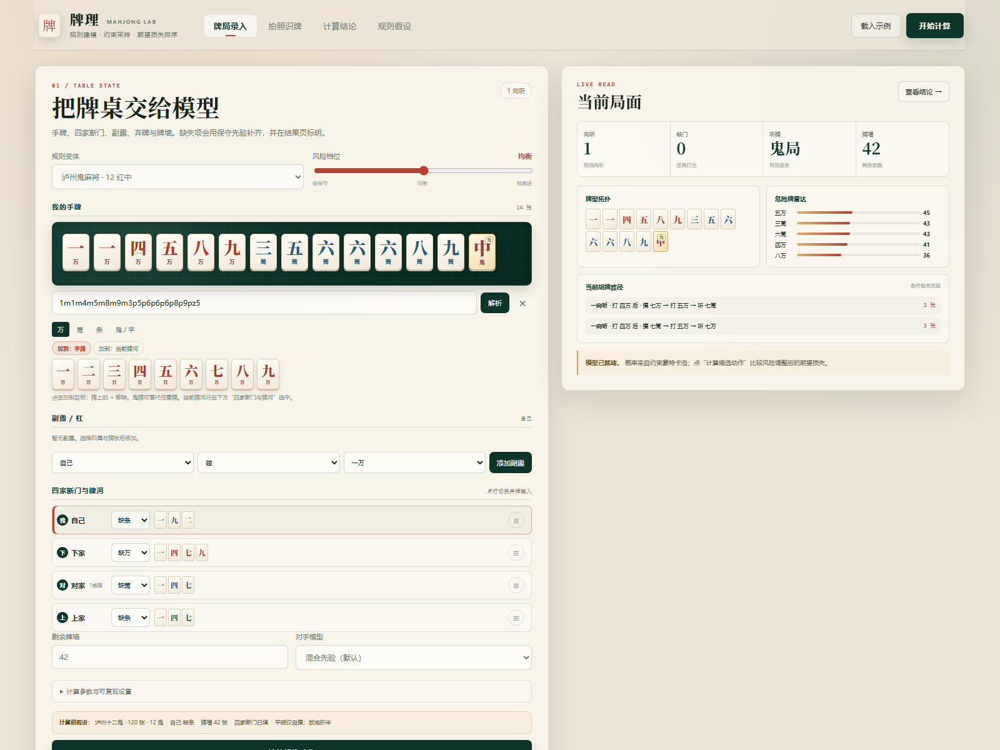
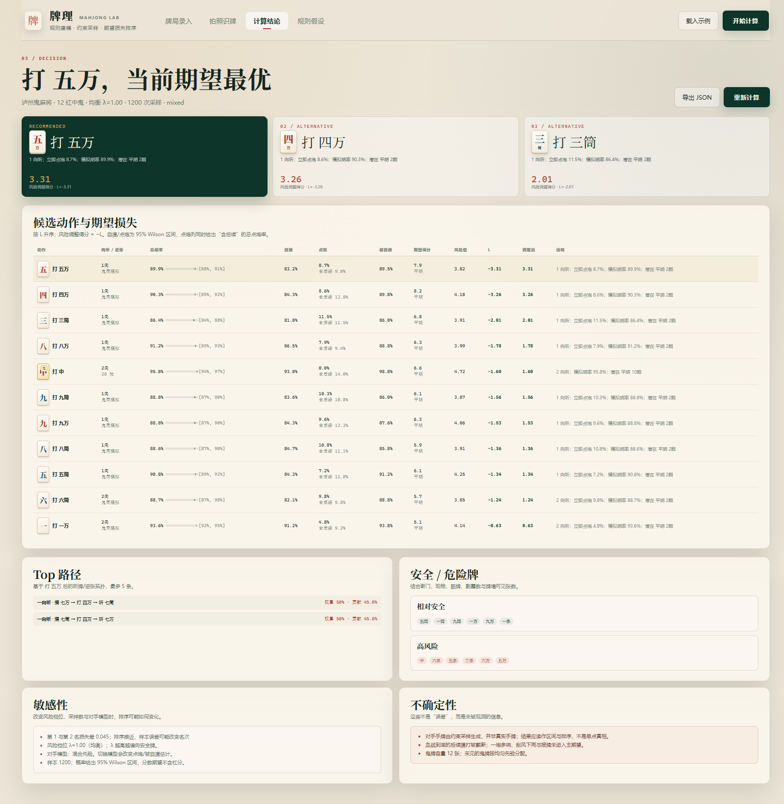

# BirdKing · 牌理 Mahjong Lab

[](https://github.com/Berlin-blog/BirdKing/actions/workflows/ci.yml)
[](LICENSE)
[](https://nodejs.org/)

面向**合法麻将娱乐与策略研究**的出牌概率计算器。支持成都麻将（血战到底、定缺、刮风下雨、番数封顶）与泸州鬼麻将（**12 张红中鬼**、40 颗封顶）。

> 不提供赌博建议。所有概率都是模型估计与区间，不是真实牌局承诺。





## 核心能力

- **规则配置表**：牌张总数、鬼牌数量、定缺、血战、一炮多响、查叫、番型/颗数、封顶、放炮折半。
- **手牌分析**：标准型、七对、全刻子、清一色、鬼牌万能、向听、有效进张、听牌。
- **四家状态**：断门、副露/杠、牌河、已胡标记、剩余牌墙、可见牌。
- **约束蒙特卡洛**：从可见牌之外的牌池采样对手手牌与牌墙，遵守断门、副露、鬼牌容量、已胡状态；带“对手已听牌”先验，避免把真实对手当成随机 13 张。
- **候选动作**：自摸率、点炮率（立即/含后续）、被自摸率、期望得分、风险值、期望损失 `L`、风险调整得分 `-L`、95% Wilson 区间。
- **默认 10,000 次采样**，界面提供 1.2k / 5k / 10k / 20k 快速切换；种子可复现。
- **Top 3**、听牌/进张路径、相对安全牌/危险牌、敏感性、不确定性、JSON 导出。
- **拍照识牌**：照片切分 + 逐张人工确认；可选接入兼容 OpenAI Chat Completions 的视觉模型。

## 快速开始

需要 Node.js 18+（建议 24）。

```bash
git clone https://github.com/Berlin-blog/BirdKing.git
cd BirdKing
node server.mjs
# 打开 http://127.0.0.1:4173
```

Windows 下也可以直接运行：

```bat
start.cmd
```

也可以直接双击 `index.html`，但建议通过本地 server 打开，以便使用 Web Worker 与可选的识牌代理。

没有第三方运行时依赖，克隆后即可运行；`npm test` 用于跑测试。

## 泸州十二鬼的规则口径

本项目以下口径实现，**不是** 4 张或 8 张鬼的常见简版：

- 120 张 = 万/筒/条各 36 张 + **12 张红中**。
- 红中为万能鬼，可替代任意牌；打出的鬼牌他家不能碰/杠/胡。
- 定缺、血战到底、一炮多响；杠分不另计（可在规则配置中扩展）。
- 计分单位“颗”，40 颗封顶；自摸按表，放炮折半并向下取整。
- 平胡不能点炮胡，只能自摸。

实现的主要计分项：

| 牌型 | 自摸 | 放炮 |
|---|---:|---:|
| 平胡（有鬼） | 2 | 1 |
| 平胡（无鬼） | 10 | 5 |
| 大对子 / 七对 / 清一色 | 10 | 5 |
| 闺对 / 龙七对 / 清闺 | 20 | 10 |
| 双闺对 / 双龙七对 / 清七对 / 清对 / 清双闺 | 40 | 20 |
| 无鬼大对子 / 无鬼七对 / 无鬼清一色 | 40 | 20 |
| 平胡杠上花 / 杠上炮 / 抢杠胡 | 10 | 5 |
| 有番型杠上花 / 杠上炮 / 抢杠胡 | 翻倍，40 封顶 | 折半 |
| 手把一 | 翻倍 | 折半 |
| 报牌 / 喜钱 | 暂不计入主期望（配置项） | — |

> 说明：`手把一` 需要显式标记；`报牌/喜钱` 默认不进入主 EV，避免把非牌局收益混进策略排序。稀有组合（天胡/地胡、特殊杠）在 `scoreLuzhou` 中保留接口，可按你的桌规继续细化。

## 计算模型

对每个候选弃牌 `a`：

```text
L(a) = -P_win(a) · E_score(a) + λ_r · Risk(a) + C_wait(a)
Risk(a) = P_deal(a) · L_deal + P_opp_selfdraw(a) · L_opp
```

- `λ_r`：风险档位 1–5 → `0.5, 0.8, 1.0, 1.3, 1.8`。
- `P_deal`：当前这张牌立即点炮的概率；`P_dealTotal` 包含后续舍牌点炮。
- `P_opp_selfdraw`：对手自摸（血战允许一炮多响/多人胡，因此它可以与 `P_win` 重叠，不是互斥事件）。
- 排序按 `L` 升序；`-L` 是风险调整得分。

### 对手模型

不是作弊读取，也不是随机发牌：

- 遵守断门、副露数、已胡状态、可见牌与鬼牌上限；
- 用牌墙进度估计“对手已听牌”先验；
- 构造将 + 面子 + 搭子的听牌手牌，而不是只从 13 张随机牌里碰运气；
- 支持随机型 / 保守型 / 激进型 / 按弃牌推断 / 混合先验。

### 已知简化

- 一次模拟在立即点炮或主要对手自摸后做截断；血战后续摸打用期望近似。
- 对手舍牌策略是快速启发式，不是完整博弈均衡。
- 刮风下雨、报牌、喜钱默认不进入主期望。
- 默认 `C_wait = 0`：等待成本已由胡牌概率与期望得分体现，不额外叠加主观罚分。
- 12 鬼局中未见鬼牌的分布按均匀先验处理；真实牌局可通过“可见牌”逐步收紧。

## 拍照识牌

纯前端没有训练数据，无法稳定识别实体麻将牌。本项目提供两条路径：

1. **切分 + 人工确认**：上传照片，设置列/行，逐张点选牌张；这是默认可用的路径。
2. **视觉模型辅助**：填写兼容 OpenAI 的 API Base / Model / Key，浏览器直连；或配置本地 `server.mjs` 代理，密钥只放在环境变量中。

```bash
# macOS / Linux
export VISION_API_KEY=sk-...
export VISION_MODEL=gpt-4o-mini
node server.mjs
```

```bat
:: Windows
set VISION_API_KEY=sk-...
set VISION_MODEL=gpt-4o-mini
node server.mjs
```

识别结果**必须人工确认**才会进入计算；重点检查红中鬼、6/9、万/条混淆。

没有照片时可点“载入示例图”，使用 `samples/sample_hand.svg` 体验切分与人工标注流程。

## 目录

```text
index.html          主界面
css/app.css         深绿麻将主题
js/tiles.js         牌张编码（0-26 花色，27-32 字牌，33 红中鬼）
js/rules.js         成都 / 泸州规则预设与配置表
js/analyzer.js      向听、胡牌、鬼牌、计分、听牌/路径
js/engine.js        约束采样、模拟、风险、期望损失
js/worker.js        计算 Worker
js/app.js           UI 与图像工作流
server.mjs          静态服务 + 可选视觉代理
tests/              规则、计分、牌池、鬼牌测试
.github/workflows/  CI
```

## 测试

```bash
npm test
```

覆盖：牌张解析、字牌/鬼编码、向听、七对、鬼牌胡牌、泸州计分表、平胡不能点炮、成都 108 / 泸州 120 牌池、十二鬼 `prepareScenario`。

## 参与贡献

欢迎提交 Issue 与 Pull Request。提交前请确保：

1. `npm test` 全部通过；
2. 涉及规则口径的改动，在 `tests/` 中补充对应用例；
3. 不要提交 API Key、真实牌局照片等敏感数据。

## 免责声明

本项目仅用于合法麻将娱乐、规则学习与策略研究。请遵守当地法律法规；不要用于赌博或任何金钱投注。

## 许可证

[MIT](LICENSE) © 2026 [Berlin-blog](https://github.com/Berlin-blog)
